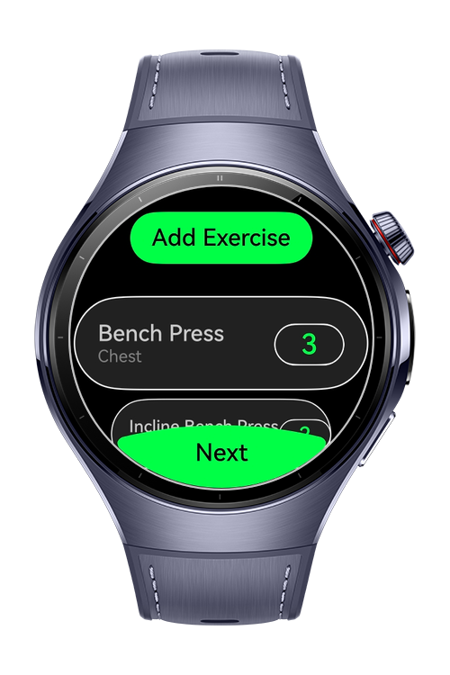
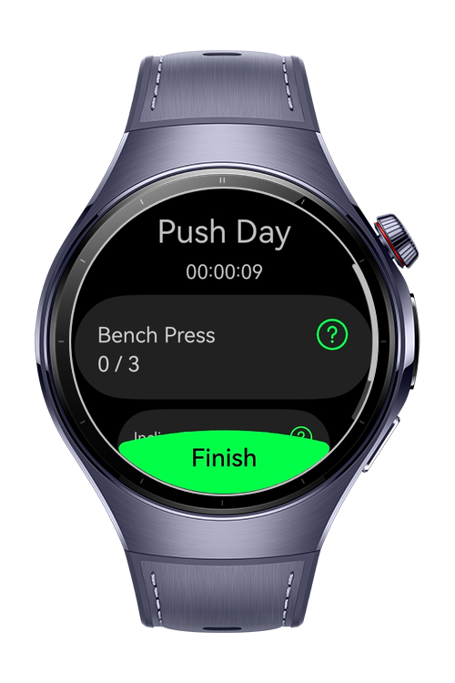
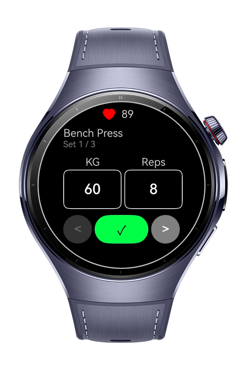
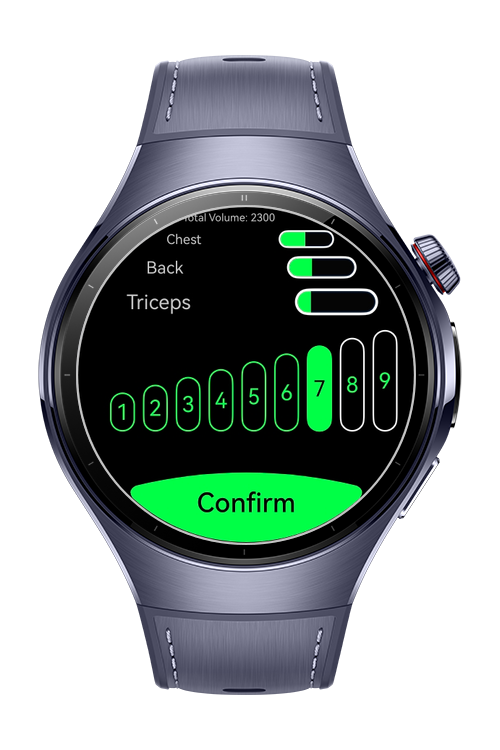

> **Note:** To access all shared projects, get information about environment setup, and view other guides, please visit [Explore-In-HMOS Index](https://github.com/Explore-In-HMOS/hmos-index).

# WearableBeFit

BeFit is a workout tracking application built for HarmonyOS. It enables users to create custom workout routines, monitor exercise progress, analyze workout intensity, and track performance metrics such as weight, sets, repetitions, and heart rate data.

# Preview

<p align="left">
  
  
  
  
</p>

# Use Cases

BeFit allows users to:
* Create custom workout routines for different days.
* Add exercises to routines.
* Track weight, sets, and repetitions for each exercise.
* Monitor workout intensity and effort.
* Analyze muscle group workload distribution.
* View historical workout data.
* Access workout analysis insights.
* Track heart rate data during workouts.
* Organize training programs systematically and monitor long-term progress.

# Tech Stack

Language: ArkTS
Framework: HarmonyOS SDK 5.1.1 (API 19)
Tools: DevEco Studio 6.0.1.251
Libraries: @kit.ArkUI, @kit.AbilityKit, @kit.ArkData, @kit.NotificationKit @kit.SensorServiceKit, @kit.BackgroundTasksKit @kit.CoreFileKit, @kit.PerformanceAnalysisKit

# Directory Structure

```

src/main/ets/
├── components/
│   ├── custom_routine/
│   │   ├── CustomRoutine.ets
│   │   ├── ExerciseList.ets
│   │   └── RoutineName.ets
│   │
│   └── exercise/
│       ├── ExerciseDefinition.ets
│       ├── ExercisePage.ets
│       ├── RoutineExercises.ets
│       └── WorkoutAnalysis.ets
│   └── HistoryDetail.ets
│   └── HomeContent.ets
│   └── MembershipInformation.ets
│   └── NearByGyms.ets
│   └── Profile.ets
│   └── QRCodeGenerator.ets
│   └── Routines.ets
│   └── WorkoutHistory.ets
│
├── di/
│   └── MainRegistry.ets
│
├── entryability/
│   └── EntryAbility.ets
│
├── entrybackupability/
│   └── EntryBackupAbility.ets
│
├── model/
│   ├── Analysis.ets
│   └── Routine.ets
│
├── myabilitystage/
│   └── MyAbilityStage.ets
│
├── pages/
│   └── Index.ets
│
├── rdb/
│   └── Rdb.ets
│
├── registry/
│   └── Injectable.ets
│   └── ServiceRegistry.ets
│   └── UIRegistry.ets
│
├── util/
│   └── Logger.ets
│   └── NotificationService.ets
│   └── PermissionHandler.ets 
│   └── PersistentStorageService.ets
│   └── ReminderService.ets
│   └── VibrationService.ets
├── viewmodel/
│   └── HeartRateVM.ets
│   └── HistoryVM.ets
│   └── RoutineVM.ets

```

# Constraints and Restrictions

## Supported Devices
* Huawei Watch 5

# License

BeFit is distributed under the terms of the MIT License.
See the [LICENSE](/LICENSE) file for more information.